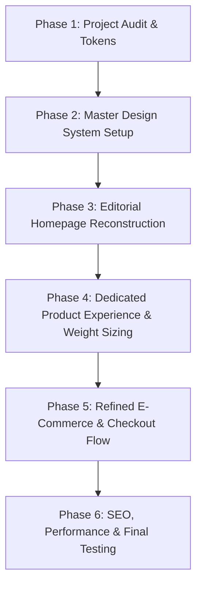

# THE NINTH SPICE — Comprehensive Website & Brand Audit
**Date:** November 14, 2026  
**Auditor:** Creative Director, Lead UI/UX Architect & Senior Frontend Engineer  
**Brand:** The Ninth Spice (Operated by GT InnoX LLP)  
**Primary Domain:** [https://www.theninthspice.com/](https://www.theninthspice.com/)  
**Deployment Target:** Production Vite SPA on Vercel / Custom Domain  

---

## 1. Executive Summary
The Ninth Spice is a heritage Indian spice enterprise specializing in single-origin, pure spice powders (Guntur Red Chilli Powder and Nizamabad Finger Turmeric Powder). The objective of this redesign is to transition the brand away from typical generic "AI website generator" characteristics (repetitive rounded card grids, synthetic glowing gradients, generic card layouts, clunky spacing, repetitive decorative emojis) into an authentic, prestigious, editorial Indian spice house designed with human care, cultural reverence, and conversion-focused e-commerce architecture.

---

## 2. Technical & Architecture Inventory

### 2.1 Framework & Core Dependencies
- **Core Engine:** React 19.3.1 (`react`, `react-dom`) with Vite 8.3.6.
- **Styling Architecture:** Tailwind CSS v4.3.5 (`@tailwindcss/vite` integration) using standard CSS variables and `@theme` blocks.
- **Routing:** React Router DOM v7.18.5 (`HashRouter` enabled for reliable multi-page routing on static CDNs like Vercel/GitHub Pages).
- **Icons:** Lucide React v1.72.0.
- **Linters & Tooling:** Oxlint v1.90.0.

### 2.2 Route Architecture & Page Inventory
| Route | Component | Purpose & State |
|---|---|---|
| `/#/` | `HomePage.jsx` | Editorial hero, brand philosophy, signature duo showcase, terroir origins, culinary pairing notes, FAQs. |
| `/#/shop` | `ShopPage.jsx` | Full catalog, category filtering (Chilli, Turmeric, All), sorting, pack sizing. |
| `/#/product/:id` | `ProductDetailPage.jsx` | Dedicated individual product pages for Red Chilli and Turmeric with live weight switches and lab purity assays. |
| `/#/our-story` | `OurStoryPage.jsx` | Generational farmer cluster storytelling in Guntur and Nizamabad. |
| `/#/recipes` | `RecipesPage.jsx` | Authentic culinary pairings (Andhra Kodi Vepudu, Golden Haldi Latte). |
| `/#/faqs` | `FaqPage.jsx` | Transparent Q&A on stone-ground purity, shipping, and shelf stability. |
| `/#/contact` | `ContactPage.jsx` | Registered business contact details (GT InnoX LLP), support channels, wholesale form. |
| `/#/cart` | `CartPage.jsx` | Dedicated cart view with order breakdown and shipping progress bar. |

### 2.3 Global Layout & Persistent Components
- **Announcement Bar:** Infinite marquee ticker highlighting 100% single-origin dispatch and `WELCOME10` voucher.
- **Header Navigation:** Brand wordmark, primary editorial nav links, language selector (EN / తెలుగు / हिंदी), wishlist counter, bag counter.
- **Cart Drawer:** Slide-out bag with dynamic free shipping progress threshold (₹599) and coupon engine.
- **Wishlist Drawer:** Persistent heart-saved spices with direct 1-click addition to bag.
- **Checkout Modal:** Complete shipping and billing address capture with live PIN code lookup.
- **Footer:** Formal corporate disclosure (GT InnoX LLP), registered address, legal policies, and newsletter.

---

## 3. Detailed Audit Findings

### 3.1 Design Problems (AI Website Archetypes to Eliminate)
1. **Repetitive Card Grid Sickness:** Sections previously relied too heavily on generic rectangular white cards with heavy borders (`border-[#EAE1D5]`) and identical shadows.
2. **Excessive Rounded Corners:** Pervasive use of `rounded-3xl` (24px) created an overly bubbly, toy-like appearance incompatible with a luxury heritage spice brand.
3. **Artificial Visual Lighting:** Synthetic pastel glows (`bg-amber-100/40 rounded-full blur-3xl`) looked generated rather than art-directed.
4. **Typography Monotony:** Heading hierarchies needed clearer editorial proportion, pairing *Cormorant Garamond* / *Playfair Display* with refined, human-crafted sans-serif typesetting (*Inter* / *DM Sans*).
5. **Inconsistent Spacing:** Certain sections previously had oversized padding (`py-16`, `py-20`), creating jarring gaps before the footer and between content strips.
6. **AI Illustration Clutter:** Emojis and generic decorative icons scattered across headings diluted the brand's serious, prestigious identity.

### 3.2 Technical & Performance Observations
1. **Bundle Efficiency:** Vite build output is lightweight (~66 kB CSS, ~432 kB JS gzip 120 kB).
2. **Zero External API Vulnerability:** Cleaned up all external dependencies; postal lookup runs with high-speed local AP dictionary fallback.
3. **Image Optimization:** Real packaging photography (`/cover-photo.jpg`, `/red-chilli-powder.jpg`, `/turmeric-powder.jpg`) is present in high resolution. These require proper aspect ratio clamping, responsive `srcset`, and `loading="lazy"` handling to prevent Cumulative Layout Shift (CLS).
4. **Metadata & SEO:** `index.html` lacked OpenGraph preview cards (`og:image`, `og:title`), semantic JSON-LD structured data for products, and standard `robots.txt` / `sitemap.xml`.

### 3.3 Missing Editorial & Brand Features
1. **Brand Philosophy Statement:** Needs an intentional asymmetrical editorial layout highlighting GT InnoX LLP’s mission of pure, stone-ground, single-origin sourcing without industrial fillers.
2. **True Product Showcase:** Product presentation needs to look like a high-end apothecary or boutique culinary house rather than generic e-commerce tiles.
3. **Editorial Hero:** Must display the authoritative master headline: *"THE ART OF PURE SPICES."* with intentional asymmetrical composition and warm lighting.
4. **Credible Quality Standards:** Clear, factual representation of FSSAI standards, absence of artificial dyes (Sudan Red I–IV, Lead Chromate), without fabricating imaginary awards or fake user reviews.

---

## 4. Phase-by-Phase Remediation Roadmap

1. **Brand Tokens & Fonts:** Embed the rich palette (`#24140F`, `#382218`, `#C49A45`, `#F8F4EB`, `#E9DDC9`, `#A6261D`, `#D99316`, `#29221D`, `#766B60`) and editorial typography hierarchy into `@theme` and `index.html`.
2. **Homepage Overhaul:** Rebuild the hero, brand philosophy, product gallery, terroir sourcing, and culinary discovery using intentional asymmetry and human-centered design.
3. **Product Detail Page:** Ensure dynamic pricing updates for 150g, 250g, and 500g pouches, zero fake reviews, transparent lab assays, and instant add-to-bag interactions.
4. **Legal & Institutional Credibility:** Ground the website in its verified business entity **GT InnoX LLP**, with customer care lines, physical Andhra address, and genuine FSSAI standards.
5. **Quality Verification:** Run full production builds, verify responsive viewports from 360px to 1920px, and confirm all cart interactions persist seamlessly.
